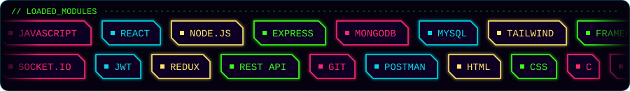
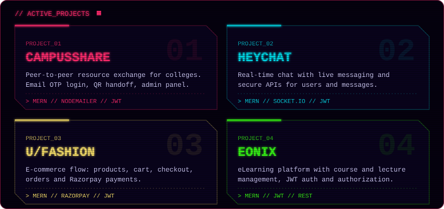
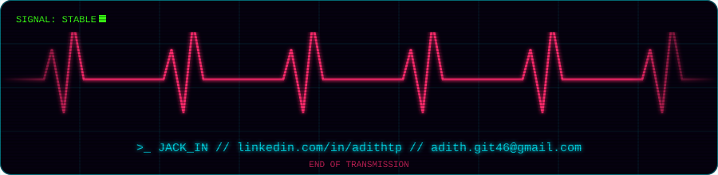

  

  

  

  

<!-- TODO: add repo links for the four projects here, e.g.
**[CampusShare](https://github.com/adithdev-glitch/REPO-NAME)** · **[HeyChat](...)** · **[U/FASHION](...)** · **[Eonix](...)**
-->

  

  <a href="https://www.linkedin.com/in/adithtp">LinkedIn</a> ·
  <a href="mailto:adith.git46@gmail.com">adith.git46@gmail.com</a>

